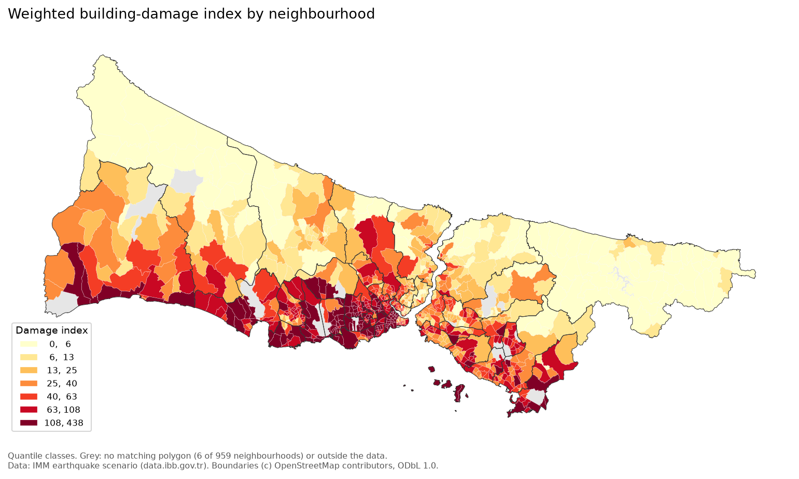
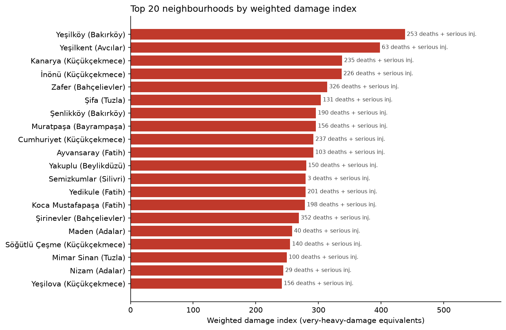
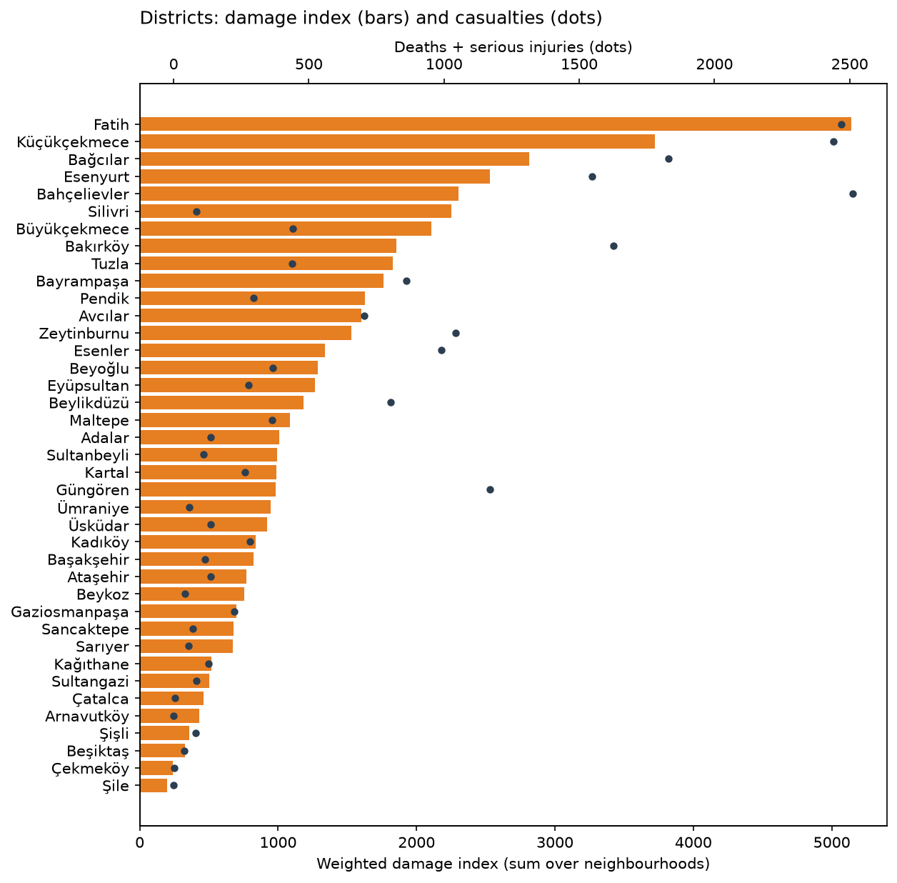
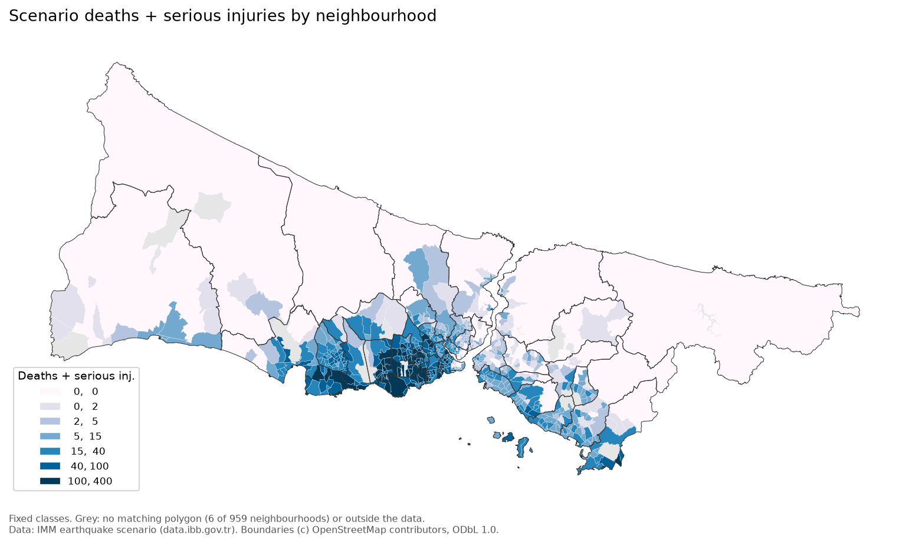
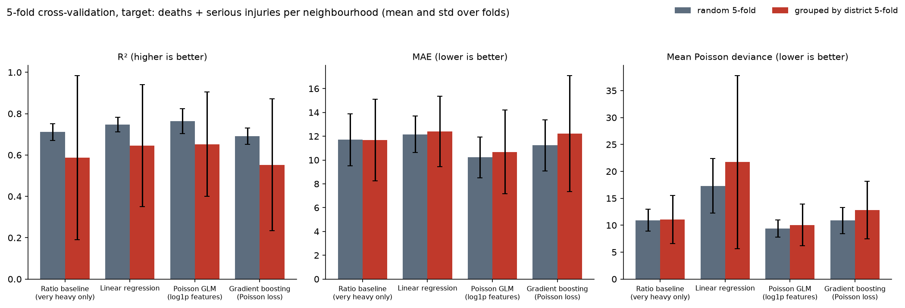
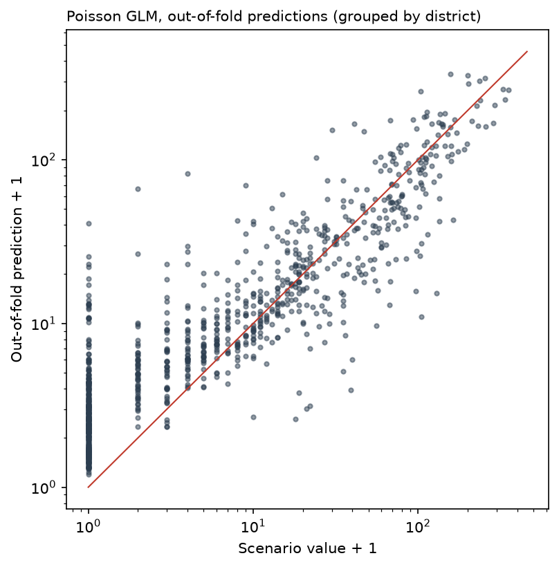

# Istanbul Earthquake Scenario Analysis

Neighbourhood-level analysis of the earthquake scenario results published by the Istanbul Metropolitan Municipality (IMM / İBB) for 959 neighbourhoods (mahalle) in 39 districts. The project builds a weighted building-damage index, ranks neighbourhoods and districts, maps the results, and cross-validates models that relate scenario casualties to scenario building damage.

**Important:** every number in the source table is an output of the municipality's scenario model for one hypothetical earthquake (estimated damage, casualties, needs). None of it is observed data. The models here measure how well the published casualty estimates can be reproduced from the published damage estimates. They do not predict outcomes of a real earthquake.



## Data and licences

| File | Content | Source and licence |
| --- | --- | --- |
| `deprem-senaryosu-analiz-sonuclar.csv` | 959 neighbourhood rows: building damage by level (very heavy, heavy, moderate, light), deaths, serious injuries, hospital treatment, light injuries, pipeline damage, temporary shelter need | IMM Open Data Portal ([data.ibb.gov.tr](https://data.ibb.gov.tr)), earthquake scenario analysis results. See the [IMM Open Data Licence](https://data.ibb.gov.tr/license); dataset-specific licence metadata is not bundled with the CSV |
| `ilce_geojson.json` | 39 district boundaries | OpenStreetMap via Nominatim, (c) OpenStreetMap contributors, ODbL 1.0 |
| `data/external/mahalle_geojson.json` (downloaded, not committed) | Neighbourhood boundaries | OpenStreetMap via Nominatim, compiled in [sahircansurmeli/istanbul-geojson](https://github.com/sahircansurmeli/istanbul-geojson) (pinned to commit `c9bf151`), (c) OpenStreetMap contributors, ODbL 1.0 |

The neighbourhood boundaries are not an official IMM layer. They are downloaded on the first run and cached in `data/external/` (git-ignored). Figures and the interactive map derived from them carry the OpenStreetMap attribution.

Notes on the CSV:

- Original CKAN resource ID: `9c3ac492-de4b-4245-b418-7ad3df67a193`, referenced by the original notebook. The local CSV is retained unchanged; the analysis does not query the live scenario API.

- It is Windows-1254 (Turkish) encoded. Reading it as `cp1254` gives correct Turkish letters; reading it as Latin-1 produces characters such as `Ý` and `Þ`.
- `EYÜP` is renamed to `EYÜPSULTAN` (the district was renamed in 2017).

## Method

### Neighbourhood polygons

Each OpenStreetMap polygon is assigned to the district polygon that contains its representative point (district names in the Nominatim addresses are not consistent). Scenario rows are then matched on normalised (district, neighbourhood) names, with 12 manual aliases for spelling differences and renames (for example Bağcılar `EVREN` is now `15 Temmuz`). The downloaded file has one missing comma between two features; the loader repairs it before parsing.

Result: **953 of 959** neighbourhoods have a polygon. The six without one are Fevzi Çakmak, Hürriyet and Kocasinan Merkez (Bahçelievler), Evliya Çelebi and İstiklal (Beyoğlu) and Gümüşyaka (Silivri). They are included in all tables and models and are only missing from the maps.

### Weighted damage index

A plain count of damaged buildings gives every severity the same weight. This analysis instead assigns weights of 1.00, 0.50, 0.10 and 0.02, prioritising very heavy damage while retaining contributions from the other levels. These are analyst-chosen severity weights, not calibrated replacement-cost ratios or official IMM weights:

```
damage_index = 1.00 * very_heavy + 0.50 * heavy + 0.10 * moderate + 0.02 * light
```

Its unit is a very-heavy-damage-equivalent building, used as a ranking proxy rather than a literal loss estimate. `severity = damage_index / damaged_buildings` is the average severity weight among damaged buildings and does not grow with neighbourhood size. The table has no building stock or population counts, so the index is not normalised by exposure.

Sensitivity to the weights (`results/weight_sensitivity.csv`):

| Scheme | Weights (vh, h, m, l) | Spearman with main ranking | Top-50 overlap with main | Spearman with deaths + serious injuries |
| --- | --- | --- | --- | --- |
| severity weights (main) | 1, 0.5, 0.1, 0.02 | 1.000 | 1.00 | 0.839 |
| linear | 4, 3, 2, 1 | 0.981 | 0.78 | 0.802 |
| equal (plain count) | 1, 1, 1, 1 | 0.958 | 0.74 | 0.779 |
| steep | 1, 0.25, 0.05, 0.01 | 0.998 | 0.96 | 0.850 |
| collapse only | 1, 0, 0, 0 | 0.959 | 0.78 | 0.874 |

The overall ranking barely changes between schemes; the exact top-50 list is more sensitive (74 to 96 percent shared).

### Models

Target: deaths + serious injuries per neighbourhood (`can_kaybi_sayisi + agir_yarali_sayisi`). Features: the four damage counts.

- Ratio baseline: casualties proportional to very heavily damaged buildings (no intercept).
- Linear regression on the four counts.
- Poisson GLM (log link) on `log1p` of the counts.
- Histogram gradient boosting with Poisson loss.

Each model is evaluated with 5-fold cross-validation twice: with random folds, and with folds grouped by district (all neighbourhoods of a district in the same fold, `GroupKFold`). Neighbourhoods in one district share building stock and distance to the fault, so random folds are optimistic; the grouped scheme tests transfer to unseen districts. Poisson deviance uses predictions floored at 0.001 because linear regression can predict negative values.

## Results

Istanbul totals in the scenario: 495,866 damaged buildings (13,496 very heavy), 14,145 deaths and 22,235 deaths + serious injuries.

### Top neighbourhoods

| Rank | Neighbourhood | District | Damage index | Severity | Damaged buildings | Very heavy | Deaths + serious inj. |
| --- | --- | --- | --- | --- | --- | --- | --- |
| 1 | Yeşilköy | Bakırköy | 438.0 | 0.240 | 1,828 | 201 | 253 |
| 2 | Yeşilkent | Avcılar | 398.0 | 0.091 | 4,366 | 36 | 63 |
| 3 | Kanarya | Küçükçekmece | 337.9 | 0.143 | 2,363 | 116 | 235 |
| 4 | İnönü | Küçükçekmece | 336.9 | 0.127 | 2,661 | 95 | 226 |
| 5 | Zafer | Bahçelievler | 314.0 | 0.121 | 2,596 | 101 | 326 |
| 6 | Şifa | Tuzla | 304.0 | 0.174 | 1,747 | 103 | 131 |
| 7 | Şenlikköy | Bakırköy | 296.1 | 0.208 | 1,425 | 110 | 190 |
| 7 | Muratpaşa | Bayrampaşa | 296.1 | 0.155 | 1,915 | 116 | 156 |
| 9 | Cumhuriyet | Küçükçekmece | 292.2 | 0.167 | 1,747 | 109 | 237 |
| 10 | Ayvansaray | Fatih | 291.8 | 0.168 | 1,741 | 111 | 103 |

The full ranking of all 959 neighbourhoods is in `results/neighbourhood_index.csv`. The 50 highest-ranked neighbourhoods hold 24 percent of the city's damage index and 31 percent of its deaths + serious injuries.



### Top districts

| Rank | District | Damage index | Damaged buildings | Deaths + serious inj. | Severity |
| --- | --- | --- | --- | --- | --- |
| 1 | Fatih | 5,141.1 | 31,286 | 2,469 | 0.164 |
| 2 | Küçükçekmece | 3,721.8 | 26,633 | 2,440 | 0.140 |
| 3 | Bağcılar | 2,816.5 | 26,019 | 1,831 | 0.108 |
| 4 | Esenyurt | 2,531.5 | 24,914 | 1,546 | 0.102 |
| 5 | Bahçelievler | 2,301.5 | 17,640 | 2,512 | 0.130 |
| 6 | Silivri | 2,252.9 | 21,303 | 85 | 0.106 |
| 7 | Büyükçekmece | 2,106.0 | 18,063 | 442 | 0.117 |
| 8 | Bakırköy | 1,853.2 | 9,421 | 1,627 | 0.197 |
| 9 | Tuzla | 1,826.8 | 15,365 | 437 | 0.119 |
| 10 | Bayrampaşa | 1,759.2 | 13,270 | 860 | 0.133 |

Silivri ranks high on damage but has few casualties in the scenario, so the damage index and the casualty estimates do not always point at the same places.





### Model comparison

5-fold cross-validation, mean over folds with the standard deviation of R² in brackets (`results/cv_summary.csv`):

| Model | Random R² | Random MAE | Random Poisson dev. | Grouped R² | Grouped MAE | Grouped Poisson dev. |
| --- | --- | --- | --- | --- | --- | --- |
| Ratio baseline (very heavy only) | 0.711 (0.040) | 11.70 | 10.92 | 0.587 (0.397) | 11.67 | 11.09 |
| Linear regression | 0.747 (0.035) | 12.16 | 17.29 | 0.646 (0.295) | 12.40 | 21.74 |
| Poisson GLM (log1p features) | **0.763** (0.060) | **10.22** | **9.42** | **0.652** (0.253) | **10.68** | **10.06** |
| Gradient boosting (Poisson loss) | 0.691 (0.040) | 11.23 | 10.87 | 0.553 (0.319) | 12.23 | 12.82 |

- The Poisson GLM is best on all three metrics in both schemes, but its R² margin over linear regression is small.
- Scores drop by about 0.1 R² when whole districts are held out, and the fold-to-fold spread becomes large (std 0.25 to 0.40). This is consistent with limited transfer across districts; it does not identify the cause of the differences.
- Gradient boosting does not beat the simpler models on 959 rows with four features.



### Which damage level drives casualties

- In the scenario there are 1.05 deaths and 1.65 deaths + serious injuries per very heavily damaged building (city totals).
- A non-negative linear fit without intercept gives 1.67 casualties per very heavily damaged building, 0.005 per lightly damaged building and 0 for heavy and moderate damage; very heavy damage accounts for 93 percent of the fitted casualties (`results/per_building_rates.csv`). The damage levels are strongly correlated, so these coefficients describe the fit, not separate effects.
- A Poisson GLM given only one damage level reaches a mean grouped-fold R² of 0.499 with very heavy damage, 0.339 with heavy, 0.187 with moderate and 0.138 with light damage (`results/single_feature_cv.csv`). Very heavy damage is the strongest single feature, but combining all four improves mean grouped-fold R² to 0.652. The file also reports pooled out-of-fold R² separately; pooling and averaging fold scores are not interchangeable.



## Interactive map

`maps/istanbul_damage_map.html` (about 3 MB) shows every neighbourhood with a polygon, coloured by damage index, with a second layer for deaths + serious injuries and an outline layer for districts. Hovering shows name, district, rank, index, severity, building and casualty counts and temporary shelter need.

GitHub shows HTML files as source code and serves the raw file as plain text, so download the file (or clone the repository) and open it in a browser. The browser needs internet access for the JavaScript libraries and OpenStreetMap tiles. GitHub Pages is not enabled for this repository.

## How to run

Python 3.12 (the pinned requirements and notebook were tested with this version). The first run downloads the neighbourhood polygons (about 12 MB), so it needs an internet connection.

```bash
python -m venv .venv
source .venv/bin/activate        # Windows: .venv\Scripts\activate
pip install -r requirements.txt

# regenerate figures/, results/ and maps/
python scripts/build_outputs.py

# or run the notebook top to bottom
jupyter nbconvert --to notebook --execute --inplace istanbul_earthquake_analysis.ipynb
```

## Layout

```
istanbul_earthquake_analysis.ipynb     executed analysis notebook
scripts/build_outputs.py               regenerates every table, figure and the map
src/eqscenario/
    data.py                            loading, encoding, derived columns
    geo.py                             district and neighbourhood polygons, name matching
    index.py                           weighted damage index and weight sensitivity
    modeling.py                        cross-validated models and per-building rates
    plots.py                           static figures and the folium map
figures/                               PNG figures used in this README
results/                               CSV tables (rankings, CV scores, sensitivity)
maps/istanbul_damage_map.html          interactive map
deprem-senaryosu-analiz-sonuclar.csv   IMM scenario results
ilce_geojson.json                      district boundaries (OpenStreetMap)
data/external/                         downloaded neighbourhood polygons (not committed)
```

## Limitations

- All values are scenario estimates for a single hypothetical earthquake, not observations.
- The neighbourhood polygons are an OpenStreetMap snapshot from 2020 and may differ from the boundaries the municipality used; six neighbourhoods have no polygon.
- Without building stock or population counts, the index measures total damage, not risk per building or per person.
- The damage weights are a modelling choice; the sensitivity table shows how much the ranking depends on them.

## License

Code: MIT, see [LICENSE](LICENSE). Data keeps the licence of its source (IMM Open Data Licence for the scenario table, ODbL 1.0 for OpenStreetMap boundaries).
