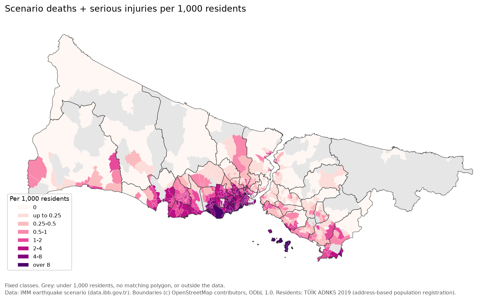
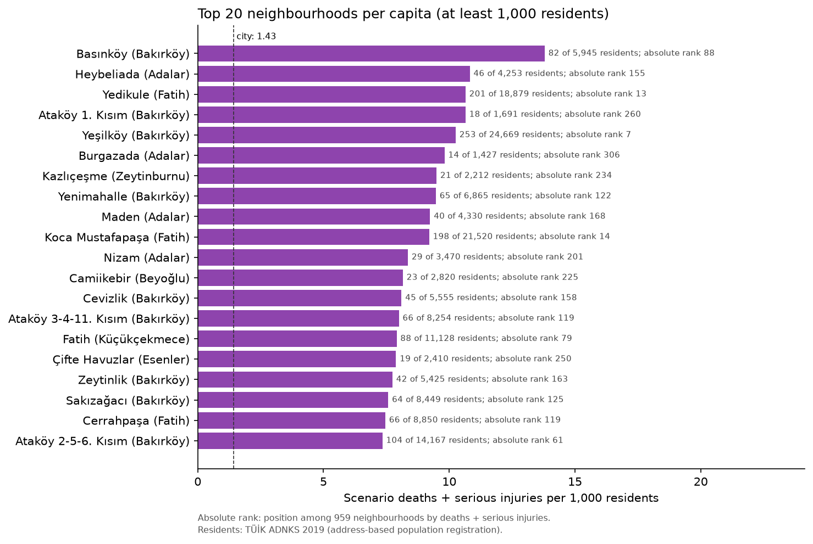
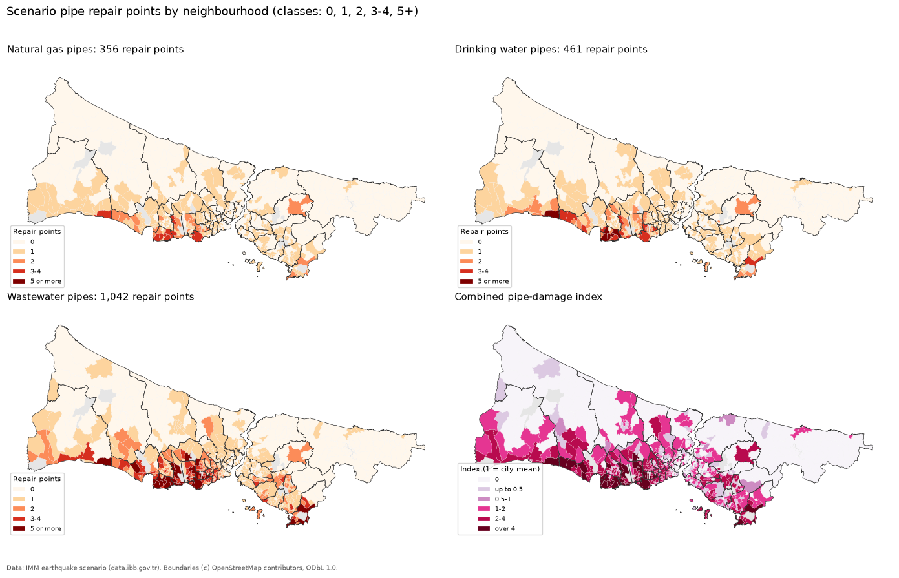
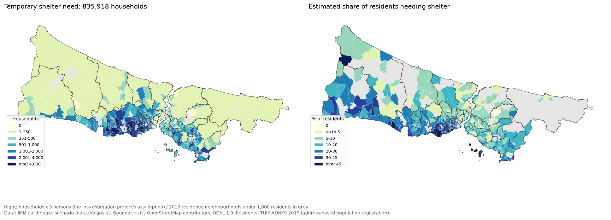
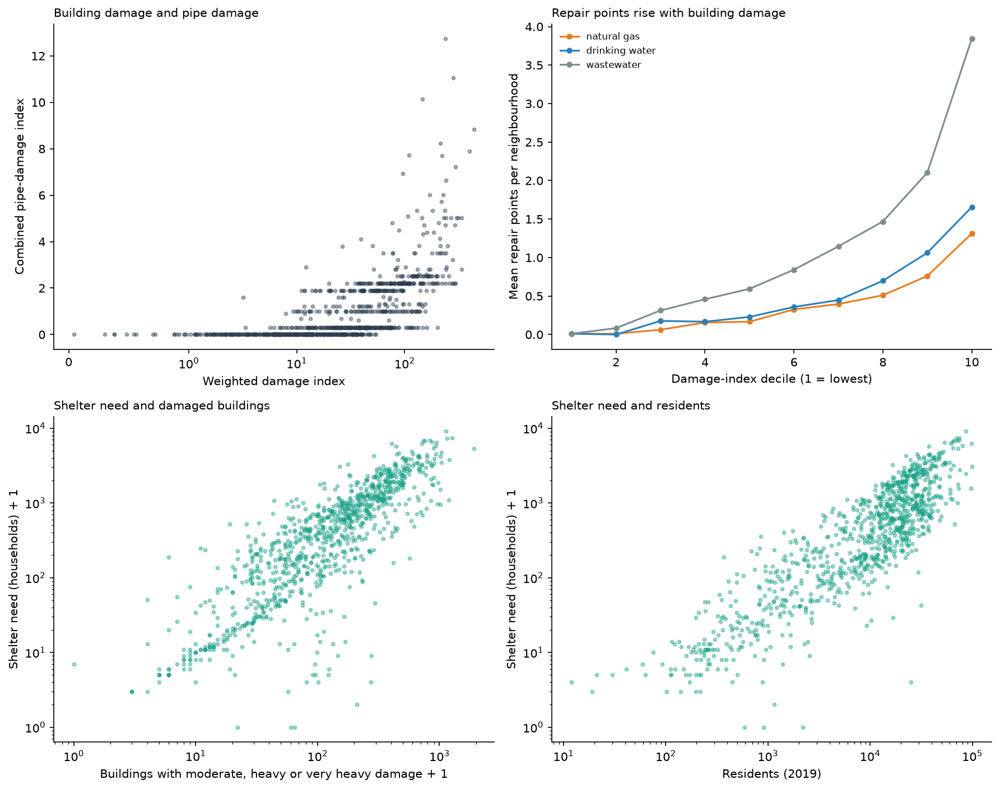

# Istanbul Earthquake Scenario Analysis

Neighbourhood-level analysis of the earthquake scenario results published by the Istanbul Metropolitan Municipality (IMM / İBB) for 959 neighbourhoods (mahalle) in 39 districts. The project builds a weighted building-damage index, ranks neighbourhoods and districts, maps the results, and cross-validates models that relate scenario casualties to scenario building damage. Official residents (TÜİK) and building counts (IMM) turn the counts into per-capita and per-building rates, and the pipeline damage and temporary shelter columns of the scenario table are analysed separately.

**Important:** every number in the source table is an output of the municipality's scenario model for one hypothetical earthquake (estimated damage, casualties, needs). None of it is observed data. The models here measure how well the published casualty estimates can be reproduced from the published damage estimates. They do not predict outcomes of a real earthquake.


## Data and licences

| File | Content | Source and licence |
| --- | --- | --- |
| `deprem-senaryosu-analiz-sonuclar.csv` | 959 neighbourhood rows: building damage by level (very heavy, heavy, moderate, light), deaths, serious injuries, hospital treatment, light injuries, pipeline damage, temporary shelter need | IMM Open Data Portal ([data.ibb.gov.tr](https://data.ibb.gov.tr)), earthquake scenario analysis results. See the [IMM Open Data Licence](https://data.ibb.gov.tr/license); dataset-specific licence metadata is not bundled with the CSV |
| `ilce_geojson.json` | 39 district boundaries | OpenStreetMap via Nominatim, (c) OpenStreetMap contributors, ODbL 1.0 |
| `data/tuik_adnks_mahalle_population_2018_2020.csv` | Residents of every Istanbul neighbourhood on 31 December 2018, 2019 and 2020, with the UAVT neighbourhood code | TÜİK address-based population registration system (ADNKS), table "Belediye, köy ve mahalle nüfusları", exported unchanged from the TÜİK MEDAS database ([biruni.tuik.gov.tr/medas](https://biruni.tuik.gov.tr/medas/?kn=95&locale=tr)) on 9 November 2026. TÜİK's [legal notice](https://www.tuik.gov.tr/Kurumsal/Yasal_Uyari) allows reuse of data from its databases without permission provided the source is cited. Source: TÜİK |
| `data/ibb_mahalle_building_counts_2017.csv` | 1,165,936 buildings in 959 neighbourhoods by construction period (before 1980, 1980 to 2000, after 2000) and floor class (1-4, 5-9, 9-19 floors), 2017 inventory | IMM Open Data Portal, dataset "Mahalle Bazlı Bina Sayıları" (`mahalle-bazli-bina-analiz-verisi`, resource `cef193d5-0bd2-4e8d-8a69-275c50288875`), IMM Open Data Licence. Retrieved unchanged from the Internet Archive copy of the resource URL (captures from 2022 and 2024 have the same content) |
| `data/external/mahalle_geojson.json` (downloaded, not committed) | Neighbourhood boundaries | OpenStreetMap via Nominatim, compiled in [sahircansurmeli/istanbul-geojson](https://github.com/sahircansurmeli/istanbul-geojson) (pinned to commit `c9bf151`), (c) OpenStreetMap contributors, ODbL 1.0 |

The neighbourhood boundaries are not an official IMM layer. They are downloaded on the first run and cached in `data/external/` (git-ignored). Figures and the interactive map derived from them carry the OpenStreetMap attribution.

Notes on the CSV:

- Original CKAN resource ID: `9c3ac492-de4b-4245-b418-7ad3df67a193`, referenced by the original notebook. The local CSV is retained unchanged; the analysis does not query the live scenario API.

- It is Windows-1254 (Turkish) encoded. Reading it as `cp1254` gives correct Turkish letters; reading it as Latin-1 produces characters such as `Ý` and `Þ`.
- `EYÜP` is renamed to `EYÜPSULTAN` (the district was renamed in 2017).
- The column units come from the project that produced the table: Boğaziçi University KOERI for IMM, ["İstanbul İli Olası Deprem Kayıp Tahminlerinin Güncellenmesi Projesi"](https://depremzemin.ibb.istanbul/uploads/prefix-dezim-kandilli-deprem-hasar-tahmin-raporu-6686737a87a92.pdf) (2019), summary pages vi and vii, and the IMM district booklets (for example [Adalar](https://depremzemin.ibb.istanbul/uploads/prefix-adalar-666ad4bcefe48.pdf), tables 5-3 and 5-4, which list the same neighbourhood values as the CSV). The scenario is a magnitude 7.5 earthquake at night.

## Method

### Neighbourhood polygons

Each OpenStreetMap polygon is assigned to the district polygon that contains its representative point (district names in the Nominatim addresses are not consistent). Scenario rows are then matched on normalised (district, neighbourhood) names, with 12 manual aliases for spelling differences and renames (for example Bağcılar `EVREN` is now `15 Temmuz`). The downloaded file has one missing comma between two features; the loader repairs it before parsing.

Result: **953 of 959** neighbourhoods have a polygon. The six without one are Fevzi Çakmak, Hürriyet and Kocasinan Merkez (Bahçelievler), Evliya Çelebi and İstiklal (Beyoğlu) and Gümüşyaka (Silivri). They are included in all tables and models and are only missing from the maps.

### Weighted damage index

A plain count of damaged buildings gives every severity the same weight. This analysis instead assigns weights of 1.00, 0.50, 0.10 and 0.02, prioritising very heavy damage while retaining contributions from the other levels. These are analyst-chosen severity weights, not calibrated replacement-cost ratios or official IMM weights:

```
damage_index = 1.00 * very_heavy + 0.50 * heavy + 0.10 * moderate + 0.02 * light
```

Its unit is a very-heavy-damage-equivalent building, used as a ranking proxy rather than a literal loss estimate. `severity = damage_index / damaged_buildings` is the average severity weight among damaged buildings and does not grow with neighbourhood size. The scenario table has no building stock or population counts, so the index itself is not normalised by exposure; the section [Per-capita risk](#per-capita-risk) adds both from external tables.

Sensitivity to the weights (`results/weight_sensitivity.csv`):

| Scheme | Weights (vh, h, m, l) | Spearman with main ranking | Top-50 overlap with main | Spearman with deaths + serious injuries |
| --- | --- | --- | --- | --- |
| severity weights (main) | 1, 0.5, 0.1, 0.02 | 1.000 | 1.00 | 0.839 |
| linear | 4, 3, 2, 1 | 0.981 | 0.78 | 0.802 |
| equal (plain count) | 1, 1, 1, 1 | 0.958 | 0.74 | 0.779 |
| steep | 1, 0.25, 0.05, 0.01 | 0.998 | 0.96 | 0.850 |
| collapse only | 1, 0, 0, 0 | 0.959 | 0.78 | 0.874 |

The overall ranking barely changes between schemes; the exact top-50 list is more sensitive (74 to 96 percent shared).

### Models

Target: deaths + serious injuries per neighbourhood (`can_kaybi_sayisi + agir_yarali_sayisi`). Features: the four damage counts.

- Ratio baseline: casualties proportional to very heavily damaged buildings (no intercept).
- Linear regression on the four counts.
- Poisson GLM (log link) on `log1p` of the counts.
- Histogram gradient boosting with Poisson loss.

Each model is evaluated with 5-fold cross-validation twice: with random folds, and with folds grouped by district (all neighbourhoods of a district in the same fold, `GroupKFold`). Neighbourhoods in one district share building stock and distance to the fault, so random folds are optimistic; the grouped scheme tests transfer to unseen districts. Poisson deviance uses predictions floored at 0.001 because linear regression can predict negative values.

## Results

Istanbul totals in the scenario: 495,866 damaged buildings (13,496 very heavy), 14,145 deaths and 22,235 deaths + serious injuries.

### Top neighbourhoods

| Rank | Neighbourhood | District | Damage index | Severity | Damaged buildings | Very heavy | Deaths + serious inj. |
| --- | --- | --- | --- | --- | --- | --- | --- |
| 1 | Yeşilköy | Bakırköy | 438.0 | 0.240 | 1,828 | 201 | 253 |
| 2 | Yeşilkent | Avcılar | 398.0 | 0.091 | 4,366 | 36 | 63 |
| 3 | Kanarya | Küçükçekmece | 337.9 | 0.143 | 2,363 | 116 | 235 |
| 4 | İnönü | Küçükçekmece | 336.9 | 0.127 | 2,661 | 95 | 226 |
| 5 | Zafer | Bahçelievler | 314.0 | 0.121 | 2,596 | 101 | 326 |
| 6 | Şifa | Tuzla | 304.0 | 0.174 | 1,747 | 103 | 131 |
| 7 | Şenlikköy | Bakırköy | 296.1 | 0.208 | 1,425 | 110 | 190 |
| 7 | Muratpaşa | Bayrampaşa | 296.1 | 0.155 | 1,915 | 116 | 156 |
| 9 | Cumhuriyet | Küçükçekmece | 292.2 | 0.167 | 1,747 | 109 | 237 |
| 10 | Ayvansaray | Fatih | 291.8 | 0.168 | 1,741 | 111 | 103 |

The full ranking of all 959 neighbourhoods is in `results/neighbourhood_index.csv`. The 50 highest-ranked neighbourhoods hold 24 percent of the city's damage index and 31 percent of its deaths + serious injuries.


### Top districts

| Rank | District | Damage index | Damaged buildings | Deaths + serious inj. | Severity |
| --- | --- | --- | --- | --- | --- |
| 1 | Fatih | 5,141.1 | 31,286 | 2,469 | 0.164 |
| 2 | Küçükçekmece | 3,721.8 | 26,633 | 2,440 | 0.140 |
| 3 | Bağcılar | 2,816.5 | 26,019 | 1,831 | 0.108 |
| 4 | Esenyurt | 2,531.5 | 24,914 | 1,546 | 0.102 |
| 5 | Bahçelievler | 2,301.5 | 17,640 | 2,512 | 0.130 |
| 6 | Silivri | 2,252.9 | 21,303 | 85 | 0.106 |
| 7 | Büyükçekmece | 2,106.0 | 18,063 | 442 | 0.117 |
| 8 | Bakırköy | 1,853.2 | 9,421 | 1,627 | 0.197 |
| 9 | Tuzla | 1,826.8 | 15,365 | 437 | 0.119 |
| 10 | Bayrampaşa | 1,759.2 | 13,270 | 860 | 0.133 |

Silivri ranks high on damage but has few casualties in the scenario, so the damage index and the casualty estimates do not always point at the same places.


### Model comparison

5-fold cross-validation, mean over folds with the standard deviation of R² in brackets (`results/cv_summary.csv`):

| Model | Random R² | Random MAE | Random Poisson dev. | Grouped R² | Grouped MAE | Grouped Poisson dev. |
| --- | --- | --- | --- | --- | --- | --- |
| Ratio baseline (very heavy only) | 0.711 (0.040) | 11.70 | 10.92 | 0.587 (0.397) | 11.67 | 11.09 |
| Linear regression | 0.747 (0.035) | 12.16 | 17.29 | 0.646 (0.295) | 12.40 | 21.74 |
| Poisson GLM (log1p features) | **0.763** (0.060) | **10.22** | **9.42** | **0.652** (0.253) | **10.68** | **10.06** |
| Gradient boosting (Poisson loss) | 0.691 (0.040) | 11.23 | 10.87 | 0.553 (0.319) | 12.23 | 12.82 |

- The Poisson GLM is best on all three metrics in both schemes, but its R² margin over linear regression is small.
- Scores drop by about 0.1 R² when whole districts are held out, and the fold-to-fold spread becomes large (std 0.25 to 0.40). This is consistent with limited transfer across districts; it does not identify the cause of the differences.
- Gradient boosting does not beat the simpler models on 959 rows with four features.


### Which damage level drives casualties

- In the scenario there are 1.05 deaths and 1.65 deaths + serious injuries per very heavily damaged building (city totals).
- A non-negative linear fit without intercept gives 1.67 casualties per very heavily damaged building, 0.005 per lightly damaged building and 0 for heavy and moderate damage; very heavy damage accounts for 93 percent of the fitted casualties (`results/per_building_rates.csv`). The damage levels are strongly correlated, so these coefficients describe the fit, not separate effects.
- A Poisson GLM given only one damage level reaches a mean grouped-fold R² of 0.499 with very heavy damage, 0.339 with heavy, 0.187 with moderate and 0.138 with light damage (`results/single_feature_cv.csv`). Very heavy damage is the strongest single feature, but combining all four improves mean grouped-fold R² to 0.652. The file also reports pooled out-of-fold R² separately; pooling and averaging fold scores are not interchangeable.


## Per-capita risk

### Residents and buildings

Both new tables carry the national address database (UAVT) neighbourhood code that the scenario table also has, so the join does not depend on names.

- **Residents:** TÜİK ADNKS counts residents at their registered address on 31 December. The analysis uses **2019**: the loss estimation project is dated 2019, the scenario is a night-time scenario that places the registered population at home, and the IMM district booklets quote the TÜİK 2019 figures (for Adalar 15,238 residents, which this table reproduces). 2018 and 2020 are kept in the file for checks.
- **Buildings:** the IMM 2017 building counts. They cover buildings with 1 to 19 floors; the scenario project's own inventory has 1,166,330 buildings, this table 1,165,936.

Join result (`results/population_join_report.csv`):

- **959 of 959** scenario neighbourhoods get a population; 951 join directly on the code.
- Eight former villages carry their old village code in the scenario table and a newer neighbourhood code at TÜİK. They are mapped explicitly in `population.UAVT_CHANGES`, and a test checks that district and name agree for each pair: Poyrazköy (Beykoz); Büyük Kılıçlı, Büyük Sinekli, Fener, Küçük Sinekli (Silivri); Bozgoca, Gökmaşlı, Teke (Şile).
- Five TÜİK neighbourhoods have no scenario row and are left out: the organised industrial zones İkitelli OSB, Beylikdüzü OSB and Dudullu OSB (113 residents together) and Finanskent and Yenişehir in Ümraniye (7,174 residents). The scenario table does not say which of its neighbourhoods covers them, so their residents (0.05 percent of the city) are not assigned.
- The building table joins 959 of 959 on the code, and no neighbourhood has more damaged buildings than buildings.

The scenario neighbourhoods have 15,511,975 residents. City-wide the scenario gives **1.43 deaths + serious injuries and 0.91 deaths per 1,000 residents**. 42.5 percent of buildings are damaged at some level and 4.1 percent heavily or very heavily, close to the 43 and 4 percent in the project report.

### Minimum population

Per-capita rankings include only neighbourhoods with **at least 1,000 residents** (811 of 959). Below that, one scenario casualty moves the rate by at least 1 per 1,000, which is about the size of the city average, and the top of the list becomes the historic commercial core of Fatih and Beyoğlu (for example 3 casualties among 112 residents in Kemankeş Karamustafapaşa, 26.8 per 1,000). The 148 excluded neighbourhoods hold 0.4 percent of residents and 44 of the 22,235 scenario casualties. With thresholds of 500 and 2,000 the top-20 list keeps 85 and 90 percent of its members (`results/per_capita_threshold_sensitivity.csv`).

### Per capita against absolute

Top 10 by deaths + serious injuries per 1,000 residents (`results/per_capita_neighbourhoods.csv`):

| Rank | Neighbourhood | District | Residents 2019 | Deaths + serious inj. | Per 1,000 | Absolute rank |
| --- | --- | --- | --- | --- | --- | --- |
| 1 | Basınköy | Bakırköy | 5,945 | 82 | 13.8 | 88 |
| 2 | Heybeliada | Adalar | 4,253 | 46 | 10.8 | 155 |
| 3 | Yedikule | Fatih | 18,879 | 201 | 10.6 | 13 |
| 4 | Ataköy 1. Kısım | Bakırköy | 1,691 | 18 | 10.6 | 260 |
| 5 | Yeşilköy | Bakırköy | 24,669 | 253 | 10.3 | 7 |
| 6 | Burgazada | Adalar | 1,427 | 14 | 9.8 | 306 |
| 7 | Kazlıçeşme | Zeytinburnu | 2,212 | 21 | 9.5 | 234 |
| 8 | Yenimahalle | Bakırköy | 6,865 | 65 | 9.5 | 122 |
| 9 | Maden | Adalar | 4,330 | 40 | 9.2 | 168 |
| 10 | Koca Mustafapaşa | Fatih | 21,520 | 198 | 9.2 | 14 |

Top 10 by absolute deaths + serious injuries, with their per-capita rank:

| Absolute rank | Neighbourhood | District | Residents 2019 | Deaths + serious inj. | Per 1,000 | Per-capita rank |
| --- | --- | --- | --- | --- | --- | --- |
| 1 | Şirinevler | Bahçelievler | 64,189 | 352 | 5.5 | 43 |
| 2 | Siyavuşpaşa | Bahçelievler | 65,518 | 337 | 5.1 | 55 |
| 3 | Zafer | Bahçelievler | 85,981 | 326 | 3.8 | 96 |
| 4 | Soğanlı | Bahçelievler | 70,571 | 290 | 4.1 | 81 |
| 5 | Bahçelievler | Bahçelievler | 61,726 | 284 | 4.6 | 64 |
| 6 | Kartaltepe | Bakırköy | 38,117 | 255 | 6.7 | 25 |
| 7 | Yeşilköy | Bakırköy | 24,669 | 253 | 10.3 | 5 |
| 8 | Cumhuriyet | Küçükçekmece | 53,147 | 237 | 4.5 | 70 |
| 9 | Kanarya | Küçükçekmece | 69,484 | 235 | 3.4 | 118 |
| 10 | Kocasinan Merkez | Bahçelievler | 74,081 | 231 | 3.1 | 131 |

Agreement between the rankings over the 811 neighbourhoods with at least 1,000 residents (`results/per_capita_rank_comparison.csv`):

| Measure | Spearman, absolute vs per capita | Spearman, non-zero only | Top-10 overlap | Top-50 overlap |
| --- | --- | --- | --- | --- |
| Deaths + serious injuries | 0.931 | 0.837 (607) | 1 of 10 | 14 of 50 |
| Deaths | 0.926 | 0.826 (607) | 1 of 10 | 16 of 50 |
| Damage index | 0.528 | 0.528 (811) | 0 of 10 | 9 of 50 |
| Shelter need | 0.637 | 0.636 (810) | 0 of 10 | 9 of 50 |

- The two casualty rankings agree on the broad pattern; part of the 0.93 comes from the 204 neighbourhoods with no casualties, which tie at the bottom of both. They disagree at the top: only Yeşilköy is in both top-10 lists. Large Bahçelievler neighbourhoods lead by count; Bakırköy, Adalar, Fatih and Zeytinburnu neighbourhoods lead per resident.
- At district level (`results/per_capita_districts.csv`, Spearman 0.915 between count and rate) Adalar has the highest rate, 9.0 per 1,000, but ranks 22nd by count. Bakırköy (7.1, 5th by count) and Fatih (5.6, 2nd by count) follow; Bahçelievler, first by count, is fourth per resident.
- The damage index per resident is led by the five Adalar neighbourhoods, which have many old buildings and few registered residents. ADNKS does not count the islands' seasonal population.
- Per building, the highest shares of heavily or very heavily damaged buildings are in Basınköy (24 percent), Yedikule (22 percent) and Yeşilköy (22 percent). Across the 811 neighbourhoods with at least 1,000 residents this share has a Spearman correlation of 0.90 with casualties per 1,000 residents.





Further figures: `figures/per_capita_vs_absolute.png` (casualties against residents), `figures/district_per_capita.png` and `figures/heavy_damage_share_map.png` (share of the building stock with heavy or very heavy damage).

### Residents as model exposure

The Poisson GLM from the model comparison was refitted with residents as exposure, once as a fixed offset `log(residents)` (casualties per resident are modelled) and once with `log(residents)` as an ordinary feature, on the same folds (`results/exposure_cv_summary.csv`):

| Model | Random R² | Random MAE | Random Poisson dev. | Grouped R² | Grouped MAE | Grouped Poisson dev. |
| --- | --- | --- | --- | --- | --- | --- |
| Poisson GLM, damage only | 0.763 (0.060) | 10.22 | 9.42 | 0.652 (0.253) | 10.68 | 10.06 |
| + log(residents) as feature | **0.880** (0.052) | **6.63** | **3.72** | 0.840 (0.099) | **7.05** | **4.13** |
| + log(residents) as offset | 0.873 (0.043) | 8.08 | 5.54 | **0.864** (0.051) | 8.10 | 5.67 |

Residents improve every metric in both schemes, and the fold-to-fold spread with held-out districts falls from 0.253 to 0.051 with the offset. This is expected: the loss estimation project places the registered night-time population in the buildings before it computes casualties, so residents are an input of the scenario model. Much of the district-to-district variation in section "Model comparison" is variation in how many people live in the damaged buildings.

## Infrastructure and shelter

### What the columns are

| Column | Meaning (project report and district booklets) | Zeros | Max | City total |
| --- | --- | --- | --- | --- |
| `dogalgaz_boru_hasari` | natural gas pipes, estimated repair points | 68% | 4 | 356 |
| `icme_suyu_boru_hasari` | drinking water pipes, estimated repair points | 62% | 7 | 461 |
| `atik_su_boru_hasari` | wastewater pipes, estimated repair points | 40% | 14 | 1,042 |
| `gecici_barinma` | temporary shelter need, households | 0.3% | 9,075 | 835,918 |
| `hastanede_tedavi_sayisi` | injured needing hospital treatment | 23% | 592 | 39,636 |
| `hafif_yarali_sayisi` | lightly injured | 17% | 1,028 | 75,240 |

All six are non-negative integers (`results/infrastructure_columns.csv`, `results/infrastructure_value_counts.csv`). The IMM data dictionary only calls them counts of damaged pipelines and of temporary shelter. The project report states that the pipe figures are sums of repair needs computed per grid cell with PGV-based empirical relations, not counts of individual leaks or breaks, and that shelter need counts the households in residential buildings with moderate, heavy or very heavy damage. The pipe totals match the report (355, 463 and 1,045 repair points). The report's headline shelter figure is about 640,000 households, while the neighbourhood table sums to 835,918; the published sources do not explain the difference.

### Pipe damage

A combined index divides each utility count by its city-wide mean per neighbourhood and averages the three ratios with equal weights, so 1 is the repair need of an average neighbourhood and zero stays zero. Z-scores were not used because two thirds of the gas values are zero and would all get the same negative score; equal weights are used because the table says nothing about the relative consequences of a gas, water or wastewater repair. Ranking by the mean percentile rank of the three utilities instead gives almost the same order (Spearman 0.999).

- Districts with the most repair points over the three networks (`results/infrastructure_districts.csv`): Beylikdüzü 125, Esenyurt 115, Büyükçekmece 113, Küçükçekmece 109, Avcılar 95. Beylikdüzü ranks 11th by casualties.
- Top neighbourhoods (`results/infrastructure_top_neighbourhoods.csv`): gas, Yeşilkent (Avcılar), Yakuplu and Dereağzı (Beylikdüzü) with 4 points each; drinking water, Dereağzı 7, Yakuplu 5, Selimpaşa (Silivri) 5; wastewater, Dereağzı 14, Yakuplu 13, Kavaklı 13. On the combined index Dereağzı, Yakuplu and Kavaklı (all Beylikdüzü) and Yeşilköy (Bakırköy) lead.
- Pipe damage follows building damage (`results/infrastructure_correlations.csv`): Spearman 0.81 between the damage index and wastewater repair points, 0.67 for drinking water, 0.61 for gas and 0.80 for the combined index. Both come from the same ground-motion field, so this is shared hazard, not one damage causing the other. Pipe length per neighbourhood is not in the table, so repair points cannot be expressed per kilometre of network.



### Shelter need

- Shelter need follows damaged buildings (Spearman 0.88) and residents (0.85). City-wide there are 4.3 shelter households per building with moderate or worse damage; the neighbourhood median is 3.5 (`results/shelter_ratio.csv`).
- With the project's assumption of 3 persons per household, 835,918 households correspond to about 16 percent of 2019 residents. At district level the estimate is 61 percent in Adalar, 38 percent in Bakırköy and 32 percent in Fatih. It divides a household count derived from the building inventory by registered residents from another source, so the 12 neighbourhoods above 50 percent should be read with caution.





## Interactive map

`maps/istanbul_damage_map.html` (about 7 MB) shows every neighbourhood with a polygon. Switchable layers colour it by damage index, deaths + serious injuries, deaths + serious injuries per 1,000 residents (grey under 1,000 residents), the combined pipe-damage index and temporary shelter need; an outline layer shows districts. Hovering shows the values behind each layer.

GitHub shows HTML files as source code and serves the raw file as plain text, so download the file (or clone the repository) and open it in a browser. The browser needs internet access for the JavaScript libraries and OpenStreetMap tiles. GitHub Pages is not enabled for this repository.

## How to run

Python 3.12 (the pinned requirements and notebook were tested with this version). The first run downloads the neighbourhood polygons (about 12 MB), so it needs an internet connection. The residents and building tables are in `data/` and need no download.

```bash
python -m venv .venv
source .venv/bin/activate        # Windows: .venv\Scripts\activate
pip install -r requirements.txt

# regenerate figures/, results/ and maps/
python scripts/build_outputs.py

# or run the notebook top to bottom
jupyter nbconvert --to notebook --execute --inplace istanbul_earthquake_analysis.ipynb
```

## Layout

```
istanbul_earthquake_analysis.ipynb     executed analysis notebook
scripts/build_outputs.py               regenerates every table, figure and the map
src/eqscenario/
    data.py                            loading, encoding, derived columns
    geo.py                             district and neighbourhood polygons, name matching
    index.py                           weighted damage index and weight sensitivity
    population.py                      residents and building stock, per-capita rates
    infrastructure.py                  pipe damage and shelter need
    modeling.py                        cross-validated models, exposure offset, per-building rates
    plots.py                           static figures and the folium map
figures/                               PNG figures used in this README
results/                               CSV tables (rankings, CV scores, sensitivity)
maps/istanbul_damage_map.html          interactive map
deprem-senaryosu-analiz-sonuclar.csv   IMM scenario results
ilce_geojson.json                      district boundaries (OpenStreetMap)
data/tuik_adnks_mahalle_population_2018_2020.csv   residents per neighbourhood (TÜİK)
data/ibb_mahalle_building_counts_2017.csv          buildings per neighbourhood (IMM)
data/external/                         downloaded neighbourhood polygons (not committed)
```

## Limitations

- All values are scenario estimates for a single hypothetical earthquake, not observations.
- The neighbourhood polygons are an OpenStreetMap snapshot from 2020 and may differ from the boundaries the municipality used; six neighbourhoods have no polygon.
- Residents are registered residents (ADNKS, 31 December 2019). They match the night-time scenario but miss seasonal and unregistered residents; per-capita rates are therefore high where few people are registered, as on the islands.
- Finanskent and Yenişehir (Ümraniye, 7,174 residents) are not in the scenario's neighbourhood list; their residents are not assigned to any scenario neighbourhood.
- The building counts are a 2017 inventory of buildings with 1 to 19 floors. The floor classes in the source overlap at 9 floors as published.
- Pipe repair points are not normalised by network length, which the table does not contain. The shelter share of residents uses the project's 3 persons per household, and the neighbourhood shelter total differs from the report's headline figure.
- The damage weights are a modelling choice; the sensitivity table shows how much the ranking depends on them.

## License

Code: MIT, see [LICENSE](LICENSE). Data keeps the licence of its source (IMM Open Data Licence for the scenario table and the building counts, TÜİK reuse terms with attribution for the residents table, ODbL 1.0 for OpenStreetMap boundaries). Residents: Türkiye İstatistik Kurumu (TÜİK), Adrese Dayalı Nüfus Kayıt Sistemi.
